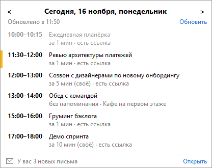
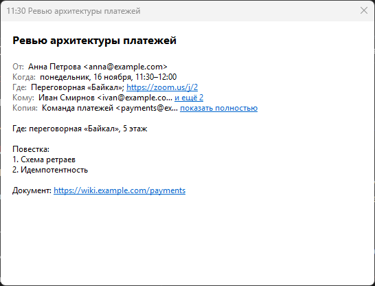
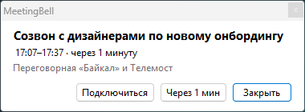
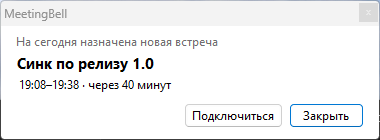
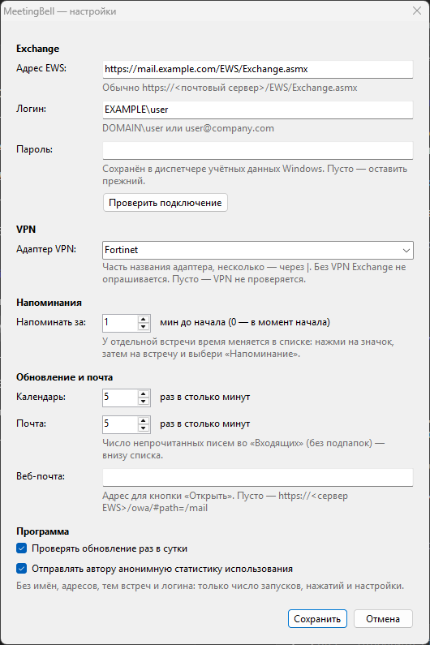

# MeetingBell

Утилита в трее Windows: показывает созвоны на сегодня (и соседние дни по стрелкам) из календаря Exchange (Outlook) и напоминает о них заранее
окном поверх всех окон. Нажми на колокольчик в трее — увидишь список дня; нажми на встречу — подключись по ссылке, открой
описание или поменяй время напоминания.

Календарь опрашивается, только когда поднят VPN: многие серверы Exchange доступны только из корпоративной сети.

**Актуальная версия** — на странице [Releases](../../releases/latest), что изменилось — в [истории версий](CHANGELOG.md).



## Установка

1. Скачай `MeetingBellSetup.exe` со страницы [последней версии](../../releases/latest), запусти и подтверди окно UAC.
2. Укажи адрес EWS сервера Exchange (обычно `https://<почтовый сервер>/EWS/Exchange.asmx`) и часть названия сетевого
   адаптера VPN (например `Fortinet` или `WireGuard`; список адаптеров системы — в выпадающем списке).
3. Нажми «Установить». Программа запустится без прав администратора, в трее появится колокольчик, и сразу откроются
   настройки: введи логин и пароль Exchange и нажми «Проверить подключение».

Права администратора нужны только установщику (папка в `Program Files`, запись в «Приложениях»). Сама программа
работает от имени пользователя.

## Как пользоваться

- **Список дня** — нажми на значок в трее левой кнопкой, повторный клик сворачивает список; сам он не закрывается. Правый клик по списку —
  то же меню, что у значка, повторный правый клик закрывает его. Прошедшие встречи серые, идущая отмечена
  полоской слева. Под темой — когда напомнить и есть ли ссылка на созвон. Список обновляется по расписанию (по умолчанию раз в 5 минут, меняется в настройках), при
  подъёме VPN и после выхода из сна; строка под заголовком показывает время последнего обновления, «Обновить»
  справа от неё обновляет сразу; при ошибке там же «Повторить» или «Настройки».
- **Другие дни** — стрелки `<` и `>` по краям строки даты листают список на день назад и вперёд: от понедельника прошлой
  недели до воскресенья следующей. Вчера и завтра загружаются при открытии списка (не чаще частоты обновления
  календаря), дальше — по одному соседнему дню при листании; пока день не загружен или его загрузка не удалась, стрелка
  серая. На других днях под датой — «Получено в ЧЧ:ММ», напоминания и уведомления о новых встречах — только для
  сегодня, у встреч прошедших дней «Напоминание» серое. «Обновить» на сегодня обновляет и соседние дни. Свёрнутый список
  открывается снова на сегодня; в полночь список закрывается.
- **Меню встречи** — клик по встрече в списке: «Подключиться», «Описание» и «Напоминание»; пока меню открыто, строка
  встречи подсвечена; повторный клик по той же встрече закрывает меню, клик по другой — открывает её меню. Пункт серый, если у встречи
  нет ссылки или описания (у встречи на весь день — и напоминания).
- **Описание** — приглашение как в веб-почте: тема, от кого, когда, где, кому и копия, ниже текст приглашения (место,
  повестка, ссылки, если организатор написал их там). Длинные «Где», «Кому» и «Копия» свёрнуты до 30 символов, ссылки
  «показать полностью» и «и ещё N» раскрывают их. Ссылки http и https в «Где» и в тексте открываются в браузере (в
  свёрнутом «Где» — тоже, целиком), правый клик по ссылке копирует её адрес. Окно закрывается крестиком или Esc.

  

- **Почта** — внизу списка строка «У вас N новых писем»: число непрочитанных писем в папке «Входящие» (письма в
  подпапках и своих папках не считаются), обновляется в фоне со своей частотой (по умолчанию раз в 5 минут), только при VPN. «Открыть» справа открывает
  веб-почту в браузере (адрес — в настройках; по умолчанию `https://<сервер EWS>/owa/#path=/mail`).
- **Своё время у встречи** — меню встречи → «Напоминание»: «По умолчанию», «В момент начала», «За 1 / 5 / 10 / 15 /
  30 мин» или «Не напоминать». У повторяющейся встречи выбор действует на всю серию (вся серия в Exchange имеет
  один UID). Если встреча 100 дней не попадается в календаре, её настройка забывается.
- **Напоминание** — окно в правом нижнем углу поверх всех окон со звуком «Календарь» Windows. Кнопки:
  «Подключиться», «Через 1 мин» и «Закрыть». Ссылка для «Подключиться» — адрес известного сервиса видеосвязи
  (Zoom, Teams, Телемост, Google Meet, Webex, Толк и др.) из места встречи или текста приглашения; если такого нет —
  первая ссылка из места встречи, и тогда на кнопке виден адрес сайта: «Подключиться (rooms.example.com)». Окно не пропадает само и не забирает фокус у того, в чём ты работаешь. Режим
  «Не беспокоить» Windows его не глушит. Несколько напоминаний встают стопкой.

  

- **Новая встреча** — если при очередном обновлении в списке дня появилась встреча, которой не было, приходит такое же
  окно с заголовком «На сегодня назначена новая встреча» и кнопками «Подключиться» (если есть ссылка) и «Закрыть». Только
  для встреч, которые начинаются не раньше чем за 30 минут до текущего времени; при первой загрузке дня и для встреч на
  весь день, для уже закончившихся встреч и для серий с «Не напоминать» уведомления нет. Встреча, перенесённая на другое время того же дня, новой не считается; перенесённая на сегодня с другого дня — считается.
  После перезапуска программы и после подъёма VPN сравнение идёт с последним загруженным списком дня, поэтому встречи,
  добавленные за это время, тоже придут уведомлением. После смены адреса или логина Exchange список прежней учётной
  записи убирается, и первая загрузка уведомлений не даёт. Если для встречи подошло время напоминания, уведомление о ней закрывается и остаётся одно окно напоминания.

  

- Встречи на весь день показываются в списке без напоминания. Отменённые и отклонённые встречи не показываются.
- Если программа запустилась, когда встреча уже началась, напоминание приходит, только пока с начала прошло меньше
  5 минут.

## Без VPN

VPN проверяется по сетевому адаптеру: адаптер, в названии или описании которого есть заданная строка, должен быть
включён. Пока его нет:

- Exchange не опрашивается, колокольчик серый (красный, если нет логина или Exchange не принял пароль), в списке — «VPN выключен, список на ЧЧ:ММ»;
- список дня, загруженный раньше, остаётся, и напоминания по нему приходят: встреча не отменяется оттого, что VPN
  отвалился;
- число непрочитанных писем внизу списка — последнее загруженное при VPN (после перезапуска программы без VPN — «Почта ещё не загружена»);
- после подъёма VPN список и число писем обновляются сразу.

Пустое поле адаптера — VPN не проверяется, Exchange опрашивается всегда.

## Значок в трее

| Значок | Что значит |
|---|---|
| Зелёный колокольчик | Всё работает |
| Серый колокольчик | VPN выключен, список — последний загруженный |
| Красный колокольчик | Нет логина Exchange или Exchange не принял пароль (так и без VPN), Exchange недоступен или ответил ошибкой |

Подсказка значка — ближайший созвон. Меню по правому клику (по значку или по списку): «Свернуть в трей» или «Развернуть», ближайший созвон, «Обновить сейчас», «Настройки…»,
«Журнал», «Запускать при входе в Windows», «Проверить обновление…», «О приложении…», «Выход». Каждый левый
клик по значку, в том числе быстрый повторный, открывает или сворачивает список.

## Настройки



| Настройка | По умолчанию | Что делает |
|---|---|---|
| Адрес EWS | `https://mail.example.com/EWS/Exchange.asmx` | Адрес веб-службы Exchange, только `https://` |
| Логин | — | `DOMAIN\user` или `user@company.com` |
| Пароль | — | Хранится в диспетчере учётных данных Windows. Пустое поле — оставить сохранённый (при том же логине). Пустой логин удаляет сохранённую запись |
| Адаптер VPN | `Fortinet` | Часть названия адаптера, несколько — через `\|`; пусто — VPN не проверяется |
| Напоминать за | 1 мин | Время напоминания по умолчанию, 0–60 минут |
| Календарь | раз в 5 мин | Как часто обновлять список встреч, от 1 до 30 минут: при более редком обновлении встреча, назначенная незадолго до начала, могла бы прийти без напоминания |
| Почта | раз в 5 мин | Как часто обновлять число непрочитанных писем, от 1 минуты до суток |
| Веб-почта | пусто | Адрес для кнопки «Открыть»; пусто — `https://<сервер EWS>/owa/#path=/mail` |
| Проверять обновление раз в сутки | включено | Уведомление в трее о новой версии |
| Анонимная статистика | как выбрано в установщике | Раздел «Статистика использования» |

«Проверить подключение» запрашивает встречи на сегодня с введёнными данными и показывает, сколько их, или ошибку.

## Логин и пароль

- Логин и пароль Exchange хранятся в **диспетчере учётных данных Windows** (Панель управления → Диспетчер учётных
  данных → Учётные данные Windows → Общие учётные данные, запись `MeetingBell:exchange`). Windows шифрует запись
  ключом пользователя; другие пользователи компьютера её не видят. В файлах программы пароля нет.
- Exchange запрашивается по HTTPS с базовой проверкой подлинности (Basic). Перенаправления не выполняются: пароль
  уходит только на указанный адрес.
- Если Exchange не принял логин или пароль, программа перестаёт опрашивать его до сохранения настроек
  или «Обновить сейчас»: повторы с неверным паролем могут заблокировать учётную запись.
- Удаление программы удаляет и запись в диспетчере учётных данных.

## Отчёты о сбоях

Включаются галочкой в установщике (по умолчанию выключена). При падении программа один раз отправляет на
aokazantsev.ru версию программы и Windows, текст ошибки и последние 100 КБ журнала. Полный список того, что уходит, —
в установщике под ссылкой «Что уходит в отчёте». Логин и пароль Exchange, темы, места, участники и ссылки встреч в
журнал не пишутся; имя пользователя Windows пишется, а оно часто совпадает с логином Exchange. Изменить выбор —
переустановить программу.

## Статистика использования

Галочка в установщике (по умолчанию включена) и в настройках. Раз в час уходят счётчики за сутки (полный список — в
установщике под ссылкой «Что уходит в статистике»): сколько раз запускалась программа, сама находила новую версию,
показывались список, напоминания и уведомления о новых встречах, сколько раз подключались по ссылке, закрывали и откладывали напоминание, меняли
время у встречи, открывали описание и ссылки в нём, копировали ссылки, открывали почту, листали дни, пользовались значком, пунктами меню, настройками и обновлением, сколько раз Exchange начинал отвечать
ошибкой; и настройки: время напоминания по умолчанию, частота обновления календаря и почты, задан ли свой адрес веб-почты (да или нет), сколько встреч со своим временем и без напоминания, проверяется
ли VPN, сохранён ли логин (да или нет), сколько встреч сегодня, автозапуск, проверка обновлений, отчёты о сбоях. Номер установки случайный. Имён, адресов, логина, тем и участников встреч в статистике нет.

## Обновление

«Проверить обновление…» в меню трея (и автопроверка раз в сутки) находит новую версию на GitHub, скачивает
установщик в `Загрузки\MeetingBell-<версия>\` и сверяет его контрольную сумму с опубликованной. «Установить сейчас»
запускает установщик; установка идёт поверх прежней версии, настройки, логин и настройки встреч сохраняются.

## Удаление

«Приложения» в параметрах Windows → MeetingBell → «Удалить» (или `Uninstall.exe` в папке установки). Удаляются
программа, автозапуск, запись в «Приложениях», папка данных и логин в диспетчере учётных данных.

## Чего программа не делает

- Не создаёт, не переносит и не отменяет встречи и не отвечает на приглашения: только читает календарь и число непрочитанных писем во «Входящих».
- Не читает сами письма, чужие календари и почту.
- Не знает о встречах, которые появились, пока VPN был выключен: список обновится после подъёма VPN.
- Работает только с Exchange по EWS (локальный Exchange или облачный с включённой Basic-авторизацией); Microsoft
  365 с одной лишь современной авторизацией (OAuth) не поддерживается.
- Пароль с кириллицей и другими не-ASCII символами может не пройти: логин и пароль уходят в UTF-8, а часть серверов
  разбирает Basic в своей кодовой странице.

## Файлы

Папка данных — `%LOCALAPPDATA%\MeetingBell`:

| Файл | Что внутри |
|---|---|
| `settings.txt` | Адрес EWS, адаптеры VPN, время напоминания по умолчанию, частота обновления, адрес веб-почты |
| `meetings.txt` | Своё время напоминания у встреч: UID встречи → минуты или «не напоминать» |
| `today.txt` | Список встреч на сегодня (последний загруженный: с организатором, участниками и текстами приглашений до 4000 символов) и уже показанные напоминания |
| `log.txt`, `log.old.txt` | Журнал (до 512 КБ, потом в `log.old.txt`) |
| `crash-reports-consent.txt`, `usage-*.txt`, `update-check*.txt` | Согласия, статистика, автопроверка обновлений |

## Сборка

Нужен только .NET Framework 4.8, который есть в Windows 10 и 11.

```
build.cmd nostart          программа MeetingBell.exe в корне репозитория
build-installer.cmd        установщик dist\MeetingBellSetup.exe
tests\run.cmd              тесты логики (напоминания, ссылки, файлы данных)
```

`src\app.ico` генерирует `src\make_icon.py` (нужен Pillow).

## Лицензия

[MIT](LICENSE)
